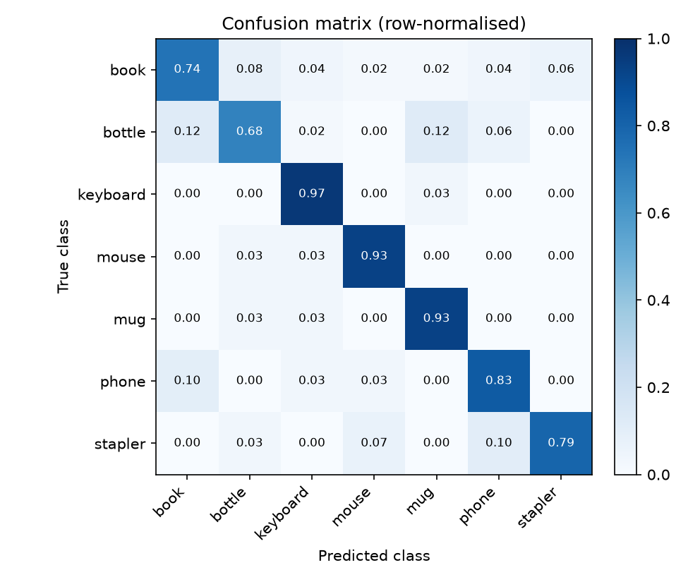

# Office Item Classifier (PDE3802 Assessment 1 – Part B)

Recognises **one office item per image** from an image file, a folder of images or a
live webcam, and reports the predicted class with its confidence.

- **Classes (7):** book · bottle · keyboard · mouse · mug · phone · stapler
- **Model:** YOLO11s-cls (Ultralytics), pretrained on ImageNet and fine-tuned on our dataset
- **Team:** Muhammad Mehdi Bhoyroo (M00983496), Ayush Joyram (M01013889), Aba Nuni Ssenyange (M00956871)
- **Demo video:** https://youtu.be/C6_ivNO-shg
- **Release:** https://github.com/mehdi00712/robotics/releases/tag/v1.0

---

## Results (held-out test set, 249 images)

Two models were trained on the same data and tested on the same 249 held-out images.
**v2 is the final model** (`models/best.pt`) because it has the higher macro-F1 and
no weak class; v1 is kept as `models/best_v1_yolo11n.pt` for comparison.

| Model | Accuracy | Macro-F1 | Uncertain (< 0.70) | Speed (CPU) |
|---|---:|---:|---:|---:|
| v1 – YOLO11n-cls (1.5 M params), 224 px, patience 10 | 0.819 | 0.815 | 67 / 249 | 21 ms / image |
| **v2 – YOLO11s-cls (5.4 M params), 224 px, patience 20** | **0.819** | **0.827** | **36 / 249** | 49 ms / image |

Per-class F1 (precision / recall in brackets):

| Class | Test images | v1 YOLO11n | v2 YOLO11s |
|---|---:|---|---|
| book | 50 | 0.843 (0.83 / 0.86) | 0.771 (0.80 / 0.74) |
| bottle | 50 | 0.800 (0.84 / 0.76) | 0.747 (0.83 / 0.68) |
| keyboard | 30 | 0.967 (0.97 / 0.97) | 0.892 (0.83 / 0.97) |
| mouse | 30 | 0.732 (0.58 / 1.00) | 0.903 (0.88 / 0.93) |
| mug | 30 | 0.968 (0.94 / 1.00) | 0.848 (0.78 / 0.93) |
| phone | 30 | 0.760 (0.95 / 0.63) | 0.794 (0.76 / 0.83) |
| stapler | 29 | 0.638 (0.83 / 0.52) | 0.836 (0.89 / 0.79) |

Confusion matrix of the final model (row-normalised – each row shows where the images
of one true class ended up):

Files for each model are in `results_v1/` and `results_v2/`: `metrics.json`,
`classification_report.txt`, `confusion_matrix.png`, `predictions.csv`, misclassified
images in `errors/<true>_as_<predicted>/`, and training curves in `train/results.png`.

---

## Installation

Requirements: **Python 3.10–3.12**, Windows / macOS / Linux, a webcam for live mode.

    git clone https://github.com/mehdi00712/robotics.git
    cd robotics
    python -m venv .venv
    # Windows:  .venv\Scripts\activate        macOS/Linux:  source .venv/bin/activate
    pip install -r requirements.txt

The trained model is included at `models/best.pt`, so you can run predictions
straight away without training.

---

## How to run

### 1. Classify an image

    python src/predict.py --image path/to/mug.jpg

Expected output:

    mug.jpg: mug (0.94)   [next: bottle 0.03, book 0.01]

If confidence is below 0.70 the answer is marked as uncertain:

    photo.jpg: uncertain (best guess: phone) (0.52)   [next: mouse 0.31, stapler 0.09]

Add `--show` to open each image in a window with the label drawn on it.

### 2. Classify a folder

    python src/predict.py --folder path/to/images

Prints one line per image and saves `predictions.csv` in that folder.

### 3. Live webcam

    python src/predict.py --camera 0

Shows the camera with the predicted class, confidence and a top-3 bar chart.
Keys: **Q/Esc** quit · **S** save snapshot (to `results/snapshots/`) · **P** pause.
For best results hold the item close so it fills about a third to two-thirds of the
picture, ideally against a plain background.

Options: `--threshold 0.6` (change the uncertain limit), `--top 5`,
`--weights models/best_v1_yolo11n.pt` (use the smaller, faster v1 model).

### 4. Desktop app (recommended)

    python src/app.py

- **Open image (O)** / **Open folder (F)** – the file window starts in `data/split/test`;
  browse a folder with the arrow keys or Prev/Next.
- **Start camera (C)** – live classification. Only the green **focus box** in the
  middle of the picture is classified, so the background does not affect the result
  (untick "classify only the focus box" to use the whole frame).
- The panel shows the predicted class, its confidence and the top-3 classes.
  Predictions below the **threshold slider** (default 0.70) are shown as "uncertain".
- **Save snapshot (S)** writes the annotated image to `results/snapshots/`.
- Reads .jpg, .png, .bmp, .webp, .jfif, .tif and .avif; iPhone .heic photos work after
  `pip install pillow-heif` (optional).

---

## Reproducing the full pipeline

    # 1. Download Open Images crops (train split: 200 per class; test split: 50 per class)
    python src/download_openimages.py --per-class 200 --split train
    python src/download_openimages.py --per-class 50 --split test

    # 2. (optional) capture own photos – keys 1-7 choose the class, B = burst, Q = quit
    python src/capture.py --room bedroom --session s01

    # 3. Split into train / val / test (by source photo / session, no leakage)
    python src/split.py

    # 4. Train
    python src/train.py                                                  # v1: YOLO11n, ~12 min
    python src/train.py --model yolo11s-cls.pt --epochs 50 --patience 20  # v2: YOLO11s, ~1 h

    # 5. Evaluate on the test set
    python src/evaluate.py

    # 6. Run the tests
    pytest -q

---

## Project structure

    data/raw/<class>/                 dataset images (see DATASET_CARD.md)
    data/raw/openimages_sources.csv   Open Images ID and split of every downloaded crop
    data/split/                       train/val/test copies (generated, not in Git)
    models/best.pt                    final model (v2, YOLO11s-cls) used by default
    models/best_v1_yolo11n.pt         smaller v1 model, kept for comparison
    src/config.py                     class list and paths shared by all scripts
    src/download_openimages.py        downloads and crops Open Images
    src/capture.py                    webcam tool for collecting own photos
    src/split.py                      group-aware train/val/test split
    src/train.py                      fine-tunes YOLO11-cls
    src/evaluate.py                   accuracy, macro-F1, confusion matrix, error images
    src/classifier.py                 model wrapper used by evaluate.py and predict.py
    src/predict.py                    command-line interface: image, folder or webcam
    src/app.py                        desktop app (Tkinter): image, folder or webcam with confidence bars
    tests/                            pytest tests (10 tests)
    results_v1/, results_v2/          metrics, plots and misclassified examples

---

## Method

- **Data:** 1,399 single-object images – 1,344 crops from Open Images V7 and 55 own
  stapler photos. Details, licences and limitations: [DATASET_CARD.md](DATASET_CARD.md).
- **Split:** 963 train / 187 validation / 249 test. Split by source photo and capture
  session, so near-duplicates never cross splits; Open Images *test-split* crops are
  always in the test set.
- **Models:** YOLO11n-cls (v1, 1.5 M parameters) and YOLO11s-cls (v2, 5.4 M parameters),
  both pretrained on ImageNet and fine-tuned at 224 × 224 px with AdamW (chosen
  automatically) and batch 32. v1 used early stopping with patience 10 (stopped at
  epoch 12), v2 patience 20 (stopped at epoch 22); both kept the epoch with the best
  validation accuracy. Ultralytics augmentation: random resized crops, horizontal
  flips, HSV colour jitter, RandAugment and random erasing.
- **Metrics:** accuracy, per-class precision / recall / F1, **macro-F1** (treats every
  class equally, important because stapler has fewer images) and a confusion matrix,
  computed once on the held-out test set.
- **Testing:** 10 automated tests (`pytest -q`) check the class list, the group-aware
  split (no leakage), cropping, metric calculation, the uncertainty threshold, the
  webcam overlay and that the trained model returns valid probabilities.

---

## Error analysis

- **Same accuracy, better balance.** Both models classify 204 of 249 test images
  correctly (81.9%), but v2 has the higher macro-F1 (0.827 vs 0.815): its errors are
  spread more evenly instead of collapsing on one class, which matters more for a
  robot that must handle every item type.
- **v1 over-predicted "mouse"** (precision 0.58, recall 1.00): about 22 images of
  other classes were labelled "mouse", and stapler (recall 0.52) and phone (0.63)
  suffered most – small, dark, compact objects. The larger v2 model learned finer
  shape differences: mouse precision rose to 0.88, stapler recall to 0.79 and phone
  recall to 0.83.
- **Stapler had the fewest training images** (63 vs 140–170) and its test images
  include a whole own webcam session that looks different from the Open Images
  staplers (domain shift). v2 still reaches F1 0.84 on it.
- **v2's weakest classes are now bottle (recall 0.68) and book (recall 0.74).** Both
  come from very varied internet photos (shelves, shop displays, tables with other
  objects), so crops often include clutter.
- **Confidence:** v2 is more decisive – only 36 test images fall below the 0.70
  "uncertain" threshold, compared with 67 for v1.
- **Validation vs test gap:** validation accuracy was 92.5% (v1) and 90.9% (v2), but
  test accuracy 81.9%. The validation set is small (187 images) and both models
  reached their best validation score at epoch 2, so validation is noisy; the test set
  also contains harder, differently sourced images (Open Images test split and an own
  capture session). The test score is the more reliable estimate.
- **Speed trade-off:** v2 is about 2–3× slower (49 vs 21 ms per image on a laptop CPU)
  but still fast enough for live webcam use (~20 frames per second).
- **Closed-set behaviour:** with no item in view the model still predicts one of the
  seven classes (e.g. "book" from a bookshelf in the background of a webcam frame).
  A "no item" class would fix this; the app's "uncertain" label reduces the problem.
- **Live webcam vs test set (domain shift).** On the live webcam the first version of
  the app classified the whole frame, and the model mostly answered book, stapler or
  keyboard. Two causes: the background (bookshelf, desk) filled most of the picture,
  and the only webcam-style training images were our own staplers, so the model linked
  the "webcam look" with stapler. Classifying only a centred focus box fixed most of
  this; adding webcam photos of every class (`src/capture.py`) and retraining is the
  next step.

**Possible improvements:** more webcam photos of every class (to reduce the domain gap
between internet photos and the robot's camera), more stapler images, a "no item /
background" class, a larger validation set so early stopping is less noisy, and testing
in an unseen room to measure robustness.

---

## Troubleshooting

| Problem | Fix |
|---|---|
| `Could not open camera 0` | Close other apps using the webcam (Teams, Zoom, browser) or try `--camera 1`. |
| `cv2.error: The function is not implemented ... cvShowImage` | The window-less OpenCV was installed. Run `pip uninstall -y opencv-python-headless opencv-python` then `pip install opencv-python`. |
| `Model not found: models/best.pt` | Train first (`python src/train.py`) or check you are in the project folder. |
| `No module named 'sympy.core'` (or another broken package) | `pip install --force-reinstall --no-deps sympy mpmath` |
| `OSError: [WinError 206] The filename or extension is too long` during install | Enable long paths in Windows (admin PowerShell: `New-ItemProperty -Path "HKLM:\SYSTEM\CurrentControlSet\Control\FileSystem" -Name LongPathsEnabled -Value 1 -PropertyType DWORD -Force`) and install inside the project's `.venv`. |
| `.venv\Scripts\activate` is blocked by PowerShell | Run `Set-ExecutionPolicy -Scope Process -ExecutionPolicy RemoteSigned` first. |
| Training is slow / "Slow image access" warning | Keep the project outside OneDrive/network drives, or lower `--batch`. |
| Training crashes with DataLoader errors on Windows | Add `--workers 0`. |
| Download stops or saves 0 crops | Re-run the same command – it resumes; check your internet connection. |
| App's "Open image" window shows no files | Choose "All files" in the type list; OneDrive "online-only" files (red ✕ / cloud icon) must be downloaded first – right-click the folder → *Always keep on this device*. |
| `Could not read photo.heic` | `pip install pillow-heif` (iPhone photos). |
| Webcam keeps predicting the same class | Keep the item inside the green box, close to the camera, on a plain background with good light. |

---

## References

- Jocher, G. and Qiu, J. (2024) *Ultralytics YOLO11*. Available at: https://github.com/ultralytics/ultralytics.
- Kuznetsova, A. *et al.* (2020) 'The Open Images Dataset V4', *International Journal of Computer Vision*, 128, pp. 1956–1981. Available at: https://doi.org/10.1007/s11263-020-01316-z.
- Redmon, J., Divvala, S., Girshick, R. and Farhadi, A. (2016) 'You only look once: Unified, real-time object detection', in *Proceedings of the 2016 IEEE Conference on Computer Vision and Pattern Recognition (CVPR)*, pp. 779–788.
- Sokolova, M. and Lapalme, G. (2009) 'A systematic analysis of performance measures for classification tasks', *Information Processing & Management*, 45(4), pp. 427–437.